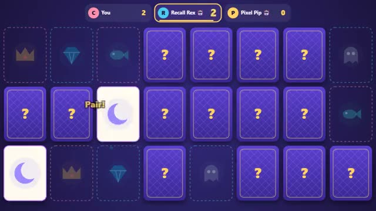

# Memory Match

Flip two. Find the pair. Go again. A multiplayer starter game from [Multiplayer Agent](https://multiplayeragent.com): 2D, turn-based, 1–4 players, with a bot that takes the empty seat.

## How it plays

On your turn flip two cards. A matching pair is yours and you go again; a miss turns them back and passes the turn. When the board is empty, most pairs wins.

**Controls:** Click or tap a card to flip it (arrows + Space work too).

## Make it yours in the Game Builder

Open the [Game Builder](https://multiplayeragent.com), choose **Start from a starter game** and pick Memory Match. It opens as version 1 in your studio, ready to play and publish. Then ask for changes, for example:

- Make the board 6 by 6 with 18 pairs
- Add a shuffle card that moves every face-down card
- Use animal faces instead of shapes

## Run it yourself

1. Get a free publishable key (`pk_…`) at [multiplayeragent.com](https://multiplayeragent.com).
2. In `index.html`, put it in place of `pk_REPLACE_ME` in the `MP_CONNECT` block.
3. Open `index.html` in a browser. No build step and no server needed.

Without a key it still runs, offline against a bot.

## How it is built

- One `index.html`. The comment at the top of the script maps the code and explains the multiplayer.
- **Host-run rules:** The host's browser checks every flip and runs the turns; if it leaves, the next player takes over.
- **Bots:** A bot takes the empty seat when you're alone, remembering some of the cards it has seen.
- **Live sync:** The host shuffles from a seed, so every screen deals the same board and sees every flip.
- **Leaderboard:** Pairs found, added up over every game, shown after each game.
- `?attract` runs it offline with bots only. The preview video is recorded from it.

## License

MIT.
